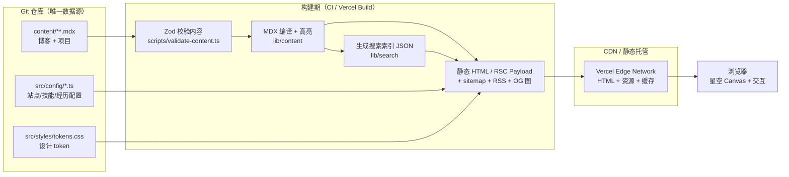
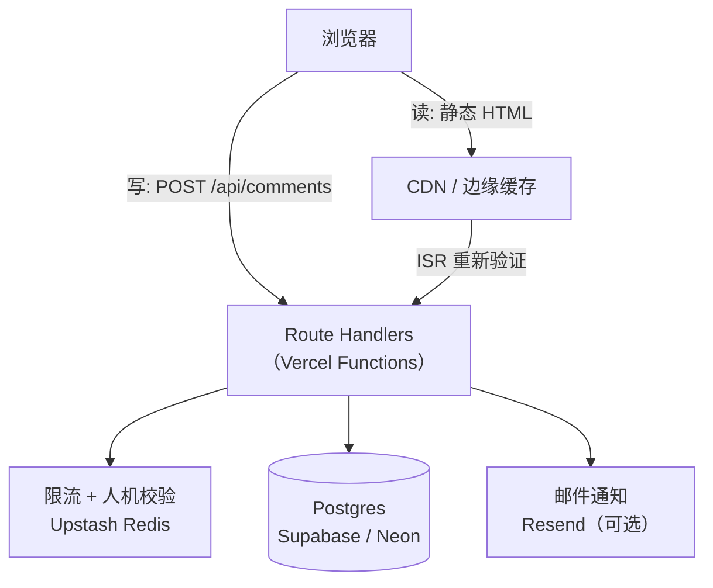
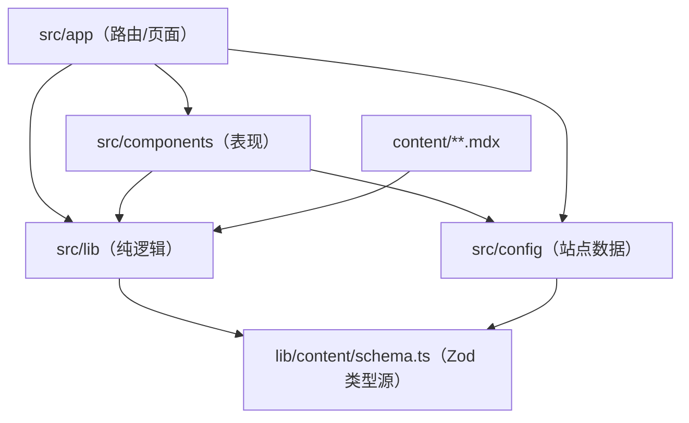
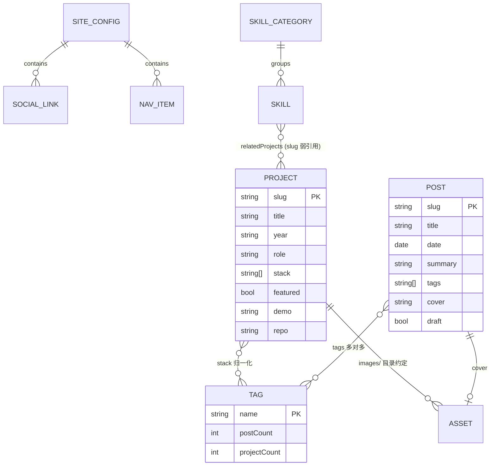

# 个人展示网站 技术设计文档（TECH DESIGN）

| 项目 | 内容 |
| --- | --- |
| 产品名称 | 个人展示网站（Portfolio，工作名 `starfolio`） |
| 文档版本 | v1.0 |
| 状态 | 待评审 |
| 日期 | 2026-10-16 |
| 关联文档 | [PRD.md](./PRD.md) |
| 目标读者 | 开发者（本人）、未来的协作者 |

---

## 0. 阅读前提：一份关键技术决策

在展开技术栈之前，必须先明确一个结论，因为它决定了后面所有内容：

> **这套产品的 v1 不需要后端，也不需要数据库。**

原因来自 PRD 的产品定位：这是一个**单作者、只读为主、内容更新频率低（周级）**的展示型站点。PRD 第 1.3 节已明确把用户注册、评论、后台管理列为非目标。在这种形态下：

- **内容源**是 Git 仓库里的 `.mdx` 文件——文件本身就是数据库，Git 本身就是版本管理、审核（PR）+ 回滚机制。
- **"接口"**在构建期就执行完了：`next build` 把 MDX 编译成静态 HTML，部署产物是纯静态文件，由 CDN 直接吐出，没有任何运行时查询。
- 引入后端和数据库不会让网站变快，只会让它变慢、变贵、变难维护，并额外交出 XSS、垃圾评论、数据泄露的风险。

因此本文档对"后端"和"数据库"给出**两套答案**：

| 阶段 | 后端 | 数据库 | 触发条件 |
| --- | --- | --- | --- |
| **v1（首版，必做）** | 无（纯静态 + 构建期渲染） | 无（MDX 文件 + 构建产物索引） | 默认形态 |
| **v2（按需演进）** | Next.js Route Handlers（同仓库）+ 托管 Postgres | Postgres（Supabase / Neon）+ Drizzle ORM + Redis（可选） | 见 2.2.2 的六条判据 |

**判据原则**：只有当某个功能**必须有服务端可写状态**、且**第三方托管方案无法满足**时，才引入后端与数据库。为了"架构完整"而加后端，是这类个人项目的典型过度设计。

### 0.1 增补：`/admin` 编辑器（本地模拟）

后来追加了一个后台编辑器（个人信息 / 技能 / 项目 / 博客 / 站点设置），因此上文"后台管理列为非目标"需要限定一句：**它不改变「v1 无后端、无数据库」的结论。**

| 项 | 结论 |
| --- | --- |
| 数据存哪里 | 浏览器 `localStorage`（键前缀 `starfolio:admin:`），不落服务端 |
| 是否有接口 | 无 `app/api/**`。取数一律走 `src/api/**`，其 `client.ts` 的 `request()` 是将来换真实后端的唯一替换点 |
| 鉴权 | 无真实鉴权。演示账号明文写在客户端产物里，仅用于挡住误入的访客，判断全程在浏览器中 |
| 是否影响前台 | 不影响。前台仍读 `content/` 与 `src/config`，构建期渲染，产物不变 |
| 与 2.2.2 判据的关系 | 第 6 条（非技术协作者网页端写文章）**仍未被满足**：本编辑器不写 Git，也不产生可发布的文章 |

因此 2.2.2 的六条判据与 2.3 的「v1 无数据库」全部仍然成立。真正的网页端写文章（改 `content/**.mdx` 并提交）依然需要服务端可写状态，方案不变。

---

## 1. 架构总览

### 1.1 v1 架构（首版目标形态）



**特征**：零运行时依赖、零数据库连接、任何一步失败都不影响线上（构建失败即不发布）。搜索、标签、目录、阅读时长全部在构建期算好。

### 1.2 v2 架构（引入动态能力后）



**关键约束**：一旦出现 `app/api/**/route.ts`，就**不能再用 `output: 'export'` 纯静态导出**，必须部署到支持 Node/Edge 运行时或 Serverless 的平台（Vercel / Cloudflare Pages Functions / Netlify Functions）。这是 v2 相对 v1 唯一不可逆的架构变化，需提前知情。

---

## 2. 技术栈选择

### 2.1 前端

| 层面 | 选型 | 版本基线 | 理由 |
| --- | --- | --- | --- |
| 框架 | **Next.js（App Router）** | 16.x | SSG 优先、文件路由、`generateMetadata` / `sitemap.ts` / `opengraph-image.tsx` 内置，SEO 成本最低；未来加 API 路由无需换栈 |
| UI 运行时 | React | 19.2 | Next 16 配套；Server Components 让博客正文零客户端 JS |
| 语言 | TypeScript | 5.x，`strict: true` | 内容 schema 与组件 props 全靠类型约束，配置错误在编辑器内暴露 |
| 样式 | **Tailwind CSS** | 4.x | token 以 CSS 变量为源、Tailwind 只做消费；深色主题与响应式成本最低 |
| 主题机制 | CSS 变量 + `data-theme` 属性 | — | 见 5.3；预留浅色槽位，v1 只发深色 |
| 内容格式 | MDX（`@next/mdx` 或 `next-mdx-remote`） | — | 允许在 Markdown 中嵌入 `<Callout>`、`<Demo>` 等组件 |
| 内容校验 | Zod | 4.x | frontmatter 类型 + 运行时校验，构建期拦截错误 |
| 语法高亮 | **Shiki**（构建期） | — | 零客户端 JS、VS Code 同源主题、支持双主题；对比 Prism 见 5.6 |
| 搜索 | Fuse.js + 构建期索引 | — | 纯静态可用；中文需特殊处理，见 5.5 |
| 动效 | CSS transition 为主，`motion`（Framer Motion）仅用于入场与路由 | — | 控制包体积，见 5.16 |
| 星空背景 | **原生 Canvas 2D** | — | PRD 已定；相比 Three.js（~600KB）体积小一个数量级，功耗低 |
| 图标 | `lucide-react`（按需引入） | — | 树摇友好，风格统一 |
| 字体加载 | `next/font`（自托管 + `font-display: swap`） | — | 见 5.10 中文字体的特殊处理 |

**渲染策略矩阵**

| 页面 | 策略 | 说明 |
| --- | --- | --- |
| `/`、`/about`、`/skills` | SSG（构建期） | 内容来自配置文件，极少变化 |
| `/projects`、`/projects/[slug]` | SSG | 构建期生成全部详情页 |
| `/blog`、`/blog/[slug]`、`/blog/tag/[tag]` | SSG | 同上；文章更新即重新构建 |
| `/rss.xml`、`/sitemap.xml`、`/robots.txt` | 构建期生成文件 | Route Handler / 内置约定 |
| 搜索索引 | 构建期 JSON，客户端按需拉取 | 首次打开搜索面板时才请求，不占首屏预算 |
| OG 图片 | 构建期或用 `opengraph-image.tsx` 动态生成 | 需注意字体加载与生成耗时，见 5.11 |

**明确不选的技术及原因**

| 候选 | 不选原因 |
| --- | --- |
| Vite + React SPA（CSR） | 首屏白屏、SEO 需额外预渲染方案，与 PRD 的 SEO/P0 目标冲突 |
| Astro | 对本项目是极佳的替代方案（更轻、islands 模型天然契合），但生态与"加后端"路径不如 Next 顺；若只想做纯静态博客，可优先考虑 Astro。**这是唯一值得重新评估的替代项** |
| Nuxt / Vue | 无技术栈偏好时无理由迁移；生态在博客场景略弱于 Next |
| Gatsby | 生态维护活跃度已下降，不推荐新项目采用 |
| WordPress | 需要 PHP 主机 + 数据库 + 插件安全维护，与"零维护"目标相悖 |
| Three.js / React Three Fiber | 仅为星空引入 3D 引擎，体积与功耗不划算（PRD 附录非目标） |
| CSS-in-JS（styled-components 等） | 运行时样式开销，与 Tailwind + CSS 变量方案重复 |

### 2.2 后端

#### 2.2.1 v1：无后端（明确的选择，不是遗漏）

v1 中所有"像是后端"的职责都被前置或外移：

| 看似需要后端 | v1 的实际做法 |
| --- | --- |
| 渲染页面 | 构建期 SSG |
| 搜索 | 构建期索引 + 浏览器内搜索 |
| 阅读量统计 | 不做精确计数（v1 用第三方轻量分析看整体趋势即可） |
| 联系方式 | `mailto:` + 一键复制（PRD F-080） |
| 定时更新内容 | 不做；有新内容就是一次 push |
| 图片处理 | 构建期 `next/image` 优化 + 提交前手动/脚本压缩 |
| 表单提交 | 首版不做（PRD F-082 列为 P2） |

#### 2.2.2 v2：什么情况下才引入后端

**六条判据**，命中任意一条才动工：

| # | 判据 | 说明 | 对应方案 |
| --- | --- | --- | --- |
| 1 | 需要展示**博客评论** | 必须有服务端可写状态 | Route Handlers + Postgres |
| 2 | 需要**点赞/表情反馈** | 同上，且需防刷 | Route Handlers + Redis 计数 |
| 3 | 需要**准确阅读量**并公开展示 | 需要服务端自增计数 | Route Handlers + Postgres/Redis |
| 4 | 需要**联系表单**且不愿暴露邮箱 | 需要服务端接收 + 反垃圾 | Route Handlers + 邮件服务（Resend） |
| 5 | 需要**邮件订阅（Newsletter）** | 需要存订阅者 + 合规退订 | Postgres + 邮件服务 |
| 6 | 非技术协作者需要**网页端写文章** | 需要 CMS 与鉴权 | 先考虑托管 CMS（如 Sanity/Contentful），而非自建后台 |

**技术选型（v2 一旦触发）**

| 层面 | 选型 | 理由 |
| --- | --- | --- |
| 接口层 | Next.js **Route Handlers**（`app/api/**/route.ts`） | 与前端同仓库、同类型定义、同一次部署；个人项目无需独立服务 |
| 运行时 | Node.js 运行时（默认），仅静态代理类接口用 Edge | Node 便于使用 ORM 与校验库 |
| 输入校验 | Zod（与服务端共享 schema） | 前端与后端同名 schema，避免重复定义 |
| 鉴权 | 仅站长需要 → 一个环境变量里的 Admin Token / 简单签名 Cookie；**不做用户体系** | 不引入 NextAuth，除非真需要第三方登录 |
| 限流与反垃圾 | Upstash Redis（滑动窗口限流）+ 蜜罐字段 + 提交耗时校验 + 内容黑名单 | 评论/表单是唯一被公开写入的入口，必须限流 |
| 邮件 | Resend（或任意 SMTP 服务） | 只用于"有人评论/留言"的通知 |
| 独立服务 | **不建**。若未来出现长任务（如批量生成 OG 图），再抽 `apps/api`（Hono / NestJS）走 monorepo | 避免过早分布式 |

**后端明确不做的事**：用户注册与登录、权限体系、管理后台 UI（评论审核直接用 Supabase 控制台或 SQL）、文件上传（图片仍走 Git）、支付。

### 2.3 数据库

#### 2.3.1 v1：无数据库。用三层"文件即数据"

| 数据类型 | v1 存储位置 | 形态 |
| --- | --- | --- |
| 博客文章、项目详情 | `content/**/*.mdx` | 长文 + frontmatter，Git 版本管理 |
| 站点配置、技能、经历、社交链接 | `src/config/*.ts` | 类型化 TS 对象，随代码一起 review |
| 派生数据（搜索索引、标签聚合、阅读时长、TOC） | 构建产物内存 / `public/search-index.json` | 每次构建重新生成，不持久化 |
| 图片与简历 PDF | `public/` | 随 Git 提交（大图建议 Git LFS 或转存图床） |
| 访客行为统计 | **不落库**，用第三方无 Cookie 分析（Umami / Vercel Analytics） | 只看趋势，不看个体 |

> 这一层的"数据库 schema"就是 4.1 节的 TypeScript 类型 + Zod schema。它是本文档中数据模型部分的主体。

#### 2.3.2 v2：Postgres 作为唯一持久化存储

| 候选 | 结论 | 理由 |
| --- | --- | --- |
| **Postgres（Supabase / Neon 免费层）** | ✅ **采用** | 关系型契合评论/计数/订阅等结构化数据；免费额度对个人站绰绰有余；Supabase 还附带控制台（可当评论审核后台）与 RLS |
| SQLite / Turso | ⚠️ 备选 | 边缘部署友好、成本极低，适合纯计数场景；但生态与"顺手加功能"的弹性不如 Postgres |
| MongoDB / Firestore | ❌ | 数据关系简单且强结构化，文档库带来的灵活性用不上，反而丢掉约束与事务 |
| Redis 作为主库 | ❌ | 持久化与查询能力不足，只能做缓存/计数辅助 |
| Redis / Upstash 作为**辅助层** | ✅ 可选 | 只用于限流、去重、高频计数，降低数据库写入压力 |

**ORM 选择**：**Drizzle ORM**。理由：轻量（类型生成无运行时负担，适配 Serverless 冷启动）、SQL-first（生成的查询可预测、易调试）、支持在 TS 中直接定义 schema 并用 `drizzle-kit` 生成迁移。备选 Prisma（开发体验好但体积与冷启动成本更高）。

**数据边界原则（重要）**

```
内容正文（博客/项目）  → 永远以 Git 里的 MDX 为准（source of truth）
动态数据（评论/计数/订阅）→ 以数据库为准
两者只通过 post_slug 这一字符串弱关联，不做外键约束跨系统
```

即：数据库**不存文章内容**，只存"围绕文章的互动数据"。删掉数据库，网站依然能完整展示所有内容——这是刻意设计的降级保底。

### 2.4 基础设施与工具链

| 层面 | 选型 | 说明 |
| --- | --- | --- |
| 托管 | **Vercel**（首选）/ Cloudflare Pages（备选） | Git push 即部署；Preview 环境可查看 `draft: true` 的草稿 |
| 域名与 DNS | 自有域名 + 平台 DNS，HTTPS 自动签发 | — |
| CI/CD | GitHub Actions（校验内容 + Lint + 测试）→ 平台构建 | 内容校验失败必须阻断部署，见 5.12 |
| 包管理 | pnpm | 磁盘与安装速度优于 npm，锁文件稳定 |
| 代码规范 | ESLint + Prettier / Biome | 单一格式化工具，避免风格争论 |
| 单元测试 | Vitest + Testing Library | 覆盖 `lib/` 纯函数（TOC 生成、阅读时长、日期格式化、搜索索引构建） |
| 端到端测试 | Playwright | 覆盖响应式断点、主题、搜索、筛选、星空降级 |
| 视觉/性能回归 | Lighthouse CI + axe-core | 达标门槛写入 CI，不达标即失败 |
| 错误监控 | 可选：Sentry（含 source map） | 纯静态站风险低，可延后 |
| 分析 | Umami / Vercel Analytics（无 Cookie） | 不引入 Google Analytics，避免 consent 弹窗 |
| 提交规范 | Conventional Commits + lint-staged | 便于自动生成变更日志 |

### 2.5 依赖体积预算

| 项 | 预算（gzip） | 说明 |
| --- | --- | --- |
| 首屏 JS 合计 | **< 150KB** | PRD 非功能指标 |
| React + Next 运行时 | ~85–100KB | 框架固定成本，无法优化掉 |
| 星空 Canvas 逻辑 | < 6KB | 手写，不引入绘图库 |
| 搜索 UI + Fuse.js | < 20KB，**按需加载** | 打开搜索面板时才拉取，不计入首屏 |
| 入场动效库 | < 20KB，**按需加载** | 若 CSS 能满足则不用 |
| Shiki / KaTeX / Mermaid | **0 KB 客户端** | 全部构建期处理；Mermaid 若需客户端渲染则动态导入 |
| 单页 CSS | < 40KB | Tailwind 4 只输出用到的类 |

**规则**：任何新增运行时依赖都需回答"它值多少 KB"，超过 10KB 的必须证明不可替代。

---

## 3. 项目结构

### 3.1 目录树

```text
personal-portfolio/
├─ .github/
│  ├─ workflows/
│  │  ├─ ci.yml                    # 内容校验 + Lint + 单测 + E2E + Lighthouse
│  │  └─ content-check.yml         # 仅改内容时的轻量校验（快速反馈）
│  └─ PULL_REQUEST_TEMPLATE.md
├─ .cursor/rules/                  # 项目内 AI 协作规则（保持精简，统一指向根目录 AGENTS.md）
├─ content/                        # ★ 内容源（唯一数据源，与代码解耦）
│  ├─ blog/
│  │  ├─ 2026-03-react-server-components.mdx
│  │  └─ 2026-07-css-container-queries.mdx
│  └─ projects/
│       └─ <slug>/                 # 每个项目一个目录（便于放多张图）
│          ├─ index.mdx
│          └─ images/
│             ├─ cover.webp
│             └─ shot-01.webp
├─ public/
│  ├─ images/
│  │  ├─ avatar.webp
│  │  └─ og-default.png            # 默认社交分享图
│  ├─ resume.pdf                   # 简历（PRD F-032）
│  ├─ favicon.ico / icon.svg
│  └─ search-index.json            # 构建期生成，勿手工编辑（见 4.3）
├─ scripts/
│  ├─ validate-content.ts          # frontmatter 校验，CI 中阻断构建
│  ├─ build-search-index.ts        # 生成搜索索引
│  ├─ check-links.ts               # 扫描 MDX 中的外链与失效相对链接
│  └─ new-post.ts                  # 脚手架：按模板生成新文章文件
├─ src/
│  ├─ app/                         # ★ 路由与页面（仅负责编排，不写业务细节）
│  │  ├─ layout.tsx                # 全局：字体、星空层、导航、页脚、metadata
│  │  ├─ page.tsx                  # 首页
│  │  ├─ globals.css               # Tailwind 入口 + 基础样式
│  │  ├─ about/page.tsx
│  │  ├─ skills/page.tsx
│  │  ├─ projects/
│  │  │  ├─ page.tsx               # 列表（筛选状态在 URL query）
│  │  │  └─ [slug]/page.tsx        # 详情
│  │  ├─ blog/
│  │  │  ├─ page.tsx               # 列表（分页）
│  │  │  ├─ [slug]/page.tsx        # 详情
│  │  │  └─ tag/[tag]/page.tsx
│  │  ├─ rss.xml/route.ts
│  │  ├─ sitemap.ts
│  │  ├─ robots.ts
│  │  ├─ opengraph-image.tsx       # 动态 OG 图（可选）
│  │  ├─ not-found.tsx             # 自定义 404（PRD F-005）
│  │  └─ error.tsx
│  ├─ components/                  # ★ 表现层，按"复用范围"分组
│  │  ├─ ui/                       # 原子组件：Button/Card/Tag/Toast/Skeleton/TOC/CodeBlock
│  │  ├─ layout/                   # Container/NavBar/TabBar/Footer/SectionHeader
│  │  ├─ stars/                    # StarField/useStarRenderer/starPresets
│  │  ├─ blog/                     # PostCard/PostList/TagCloud/SearchDialog/Pagination
│  │  ├─ projects/                 # ProjectCard/ProjectFilter/Gallery/Lightbox
│  │  └─ mdx/                      # MDX 可用的自定义组件：Callout/Figure/Steps/Demo
│  ├─ lib/                         # ★ 纯逻辑，无 React 依赖（可单测）
│  │  ├─ content/
│  │  │  ├─ schema.ts              # Zod schema（数据模型的单一事实来源）
│  │  │  ├─ loader.ts              # 读取 content/、解析 frontmatter、排序
│  │  │  ├─ toc.ts                 # 由 MDX 生成目录树
│  │  │  └─ reading-time.ts        # 中英混排阅读时长估算
│  │  ├─ search/
│  │  │  ├─ build-index.ts         # 构建期：切词 + 生成 SearchDoc[]
│  │  │  └─ fuse-config.ts         # 阈值、权重配置
│  │  ├─ seo/
│  │  │  ├─ metadata.ts            # 统一的 generateMetadata 封装
│  │  │  └─ jsonld.ts              # Person / BlogPosting 结构化数据
│  │  └─ utils/                    # cn/date/format/slugify
│  ├─ config/                      # ★ 可直接编辑的站点数据（非 MDX）
│  │  ├─ site.ts                   # 姓名、定位、导航、社交链接（PRD F-025）
│  │  ├─ skills.ts                 # 技能分类与三档熟练度（PRD 4.5）
│  │  ├─ timeline.ts               # 经历时间线（PRD F-031）
│  │  └─ theme.ts                  # token 常量（供 CSS 与 TS 共享，避免两处维护）
│  ├─ styles/
│  │  └─ tokens.css                # PRD 附录 C 的 token 定义
│  ├─ hooks/                       # useReducedMotion/useScrollParallax/useMediaQuery
│  └─ types/                       # 全局类型与内容类型导出
├─ tests/
│  ├─ unit/                        # 覆盖 src/lib/**
│  └─ e2e/                         # Playwright：响应式、星空降级、搜索、筛选
├─ docs/
│  ├─ PRD.md
│  └─ TECH_DESIGN.md               # 本文档
├─ AGENTS.md                       # ★ AI 编码助手规范（必读，见根目录）
├─ .env.example
├─ .nvmrc / .node-version
├─ next.config.ts
├─ tailwind.config.ts（若 v4 仍需）
├─ tsconfig.json
├─ package.json
└─ README.md
```

### 3.2 分层与依赖规则



**依赖方向铁律（违反即 review 不通过）**

1. 依赖只能**从上往下**：`app → components → lib`，反向引用一律禁止。
2. `src/lib/**` 里**不允许 import React**，也不允许读取 `process.env`（除构建脚本）。保证可纯函数单测。
3. `src/components/ui/**` 是**无业务组件**：不得 import `lib/content` 或任何内容 schema，只接受 props。
4. 内容相关的一切（解析、排序、过滤）只发生在 `lib/content`，页面与组件不得自行 `fs.readFile`。
5. `content/` 与 `src/` 之间**没有反向写入**：内容文件不允许 import 源码，源码只能读取内容。
6. 数据模型只在 `lib/content/schema.ts` 定义一次；其他地方的 TS 类型必须 `z.infer` 派生，不得手写重复接口。

### 3.3 "这段代码该放哪" 的决策规则

| 问题 | 判定 |
| --- | --- |
| 它是纯函数/数据转换吗？ | → `src/lib/<domain>/` |
| 它是可复用的视觉元素且不知道任何业务吗？ | → `src/components/ui/` |
| 它只在一个页面的特定区块出现吗？ | → 与该页面同级放 `_components/`（下划线前缀，不进路由） |
| 它是位置固定的骨架（导航/页脚/容器）吗？ | → `src/components/layout/` |
| 它是会被写进 MDX 正文的组件吗？ | → `src/components/mdx/` 并在 MDX 组件映射中注册 |
| 它是可编辑的内容数据而非长文吗？ | → `src/config/*.ts` |
| 它是长文/图文内容吗？ | → `content/**.mdx` |

### 3.4 命名与编码约定

| 对象 | 规则 | 示例 |
| --- | --- | --- |
| 组件文件 | PascalCase，与组件同名 | `ProjectCard.tsx` |
| 工具/纯函数文件 | kebab-case | `reading-time.ts` |
| Hook | `use` 前缀 | `useScrollParallax.ts` |
| 内容文件（博客） | `YYYY-MM-DD-slug.mdx` | `2026-03-react-rsc.mdx` |
| 内容目录（项目） | 小写连字符 slug | `content/projects/star-map/index.mdx` |
| 组件 props 类型 | `<组件名>Props` | `ProjectCardProps` |
| 样式 | 只用 Tailwind 类 + token 变量，禁止行内魔法数字 | `className="rounded-lg bg-surface-700"` |
| 服务端/客户端 | 默认 Server Component，需要交互才加 `'use client'`，且尽量下沉到最小叶子节点 | 星空、搜索、筛选、主题切换为客户端 |

### 3.5 环境变量

```bash
# .env.example

# --- v1 必需 ---
NEXT_PUBLIC_SITE_URL=https://example.com      # canonical / sitemap / OG 图的绝对地址来源
NEXT_PUBLIC_SITE_NAME=你的名字

# --- v1 可选 ---
NEXT_PUBLIC_ANALYTICS_ID=                     # 无 Cookie 分析站点 ID
CONTENT_INCLUDE_DRAFTS=false                  # 本地开发可设 true，生产必须 false

# --- v2 才需要（引入后端/数据库后） ---
DATABASE_URL=                                 # Supabase/Neon 连接串（服务端专用，禁止 NEXT_PUBLIC_）
SUPABASE_URL=
SUPABASE_SERVICE_ROLE_KEY=                    # 仅服务端使用，绝不可暴露到客户端
UPSTASH_REDIS_REST_URL=                       # 限流用
UPSTASH_REDIS_REST_TOKEN=
RESEND_API_KEY=                               # 评论/留言通知邮件
ADMIN_TOKEN=                                  # 站长审核接口的简易鉴权
```

**规则**：`NEXT_PUBLIC_` 前缀的一切都会被编译进客户端产物，视为公开信息；任何密钥、连接串、Token 必须无前缀且只在 Route Handler / 构建脚本中使用。

---

## 4. 数据模型

### 4.1 v1：内容模型（TS 类型 + Zod 校验）

这是 v1 真正的"数据库 schema"。定义在 `src/lib/content/schema.ts`，被 `loader.ts` 用于构建期校验，类型通过 `z.infer` 派生。

```ts
import { z } from 'zod';

/* ---------- 通用 ---------- */
export const Tag = z.string().min(1).max(24);

/** 日期统一按 YYYY-MM-DD 字符串存储，避免构建期时区漂移（见 5.14） */
const DateString = z.string().regex(/^\d{4}-\d{2}-\d{2}$/);

/* ---------- 博客 ---------- */
export const PostFrontmatter = z.object({
  title: z.string().min(1).max(80),
  date: DateString,
  updated: DateString.optional(),
  summary: z.string().min(1).max(160),
  tags: z.array(Tag).min(1).max(5),
  cover: z.string().optional(),          // 相对 public/ 的路径
  draft: z.boolean().default(false),
  lang: z.enum(['zh', 'en']).default('zh'),
});
export type PostFrontmatter = z.infer<typeof PostFrontmatter>;

/** Post = frontmatter + 构建期派生字段 */
export type Post = PostFrontmatter & {
  slug: string;              // 由文件名派生
  content: string;           // 编译后的 MDX/HTML
  toc: TocItem[];            // 目录树
  readingMinutes: number;    // 估算阅读时长
  headingsCount: number;     // 用于判断是否需要 TOC
};

export type TocItem = { id: string; text: string; level: 2 | 3 | 4 };

/* ---------- 项目 ---------- */
export const ProjectFrontmatter = z.object({
  title: z.string().min(1).max(60),
  year: z.string().regex(/^\d{4}$/),
  role: z.string().min(1).max(40),         // 我的角色：独立开发 / 前端负责人 …
  stack: z.array(z.string()).min(1).max(10),
  summary: z.string().min(1).max(120),     // 卡片上的一句话
  cover: z.string(),                       // 必填：卡片视觉
  featured: z.boolean().default(false),    // 首页精选（PRD F-024）
  status: z.enum(['active', 'completed', 'archived']).default('completed'),
  demo: z.string().url().optional(),
  repo: z.string().url().optional(),
  metrics: z.array(z.string()).max(4).default([]),  // "首屏 3.2s → 1.1s"
  order: z.number().default(0),            // 同一年内的手工排序权重
});
export type Project = z.infer<typeof ProjectFrontmatter> & {
  slug: string;
  content: string;
  toc: TocItem[];
};

/* ---------- 站点配置（src/config/*.ts） ---------- */
export type SocialLink = {
  id: string;
  label: string;                              // 展示名：GitHub
  href: string;
  icon: 'github' | 'mail' | 'x' | 'juejin' | 'wechat';
  handle?: string;                            // 展示用账号名
};

export type TimelineItem = {
  id: string;
  period: string;                             // "2025.03 – 至今"
  title: string;
  org?: string;
  description: string;
  tags?: string[];
  status?: 'ongoing' | 'done';
};

export type SkillLevel = 'proficient' | 'familiar' | 'learning';  // 三档，对应 PRD F-041
export type Skill = {
  name: string;
  level: SkillLevel;
  relatedProjects?: string[];                 // 关联项目 slug，支撑 PRD F-042
  note?: string;                              // 悬停说明（PRD F-044）
};
export type SkillCategory = {
  id: string;                                 // frontend / backend / tooling / design
  label: string;
  icon: string;
  skills: Skill[];
};

export type SiteConfig = {
  name: string;
  role: string;                               // 一句话定位
  keywords: string[];                         // 首屏 3 个关键词
  email: string;
  resumeUrl: string;
  socials: SocialLink[];
  nav: { href: string; label: string }[];
  meta: { description: string; ogImage: string; locale: 'zh-CN' };
};
```

### 4.2 实体关系



**关系说明**

| 关系 | 实现方式 | 说明 |
| --- | --- | --- |
| 文章 ↔ 标签 | frontmatter 数组，构建期反向聚合出 `Tag` 实体 | 标签不是独立文件，是派生实体 |
| 技能 ↔ 项目 | `relatedProjects: string[]` 存 slug | 弱引用，校验时检查 slug 是否存在（见 5.12） |
| 项目 ↔ 图片 | 目录约定 `content/projects/<slug>/images/` | 不建 Asset 表，靠约定 + 构建期校验 |
| 文章 ↔ 项目 | v1 不做关联；若要，加 `relatedProjects` 字段复用同一校验 | — |

### 4.3 v1 派生数据（构建期生成，不持久化）

| 派生数据 | 生成位置 | 消费方 | 规则 |
| --- | --- | --- | --- |
| `Tag[]` 聚合 | `lib/content/loader.ts` | 标签云、`/blog/tag/[tag]` | 归一去重，按文章数降序 |
| 阅读时长 | `lib/content/reading-time.ts` | 文章卡片与详情 | 中文按 350 字/分钟、英文按 200 词/分钟分别累计后合并；向上取整，最小 1 分钟 |
| 目录 TOC | `lib/content/toc.ts` | 文章页 TOC | 取 h2–h4，生成稳定 `id`（避免中文 id，使用 `h-<序号>-<slugified>`） |
| 搜索索引 | `scripts/build-search-index.ts` → `public/search-index.json` | 客户端搜索面板 | 字段见下方 `SearchDoc`；**截断正文前 1200 字符**控制体积 |
| RSS | `app/rss.xml/route.ts` | 订阅者 | 最近 20 篇，`draft` 排除 |
| Sitemap | `app/sitemap.ts` | 搜索引擎 | 全部非草稿页面，含 `lastModified` |
| 上一/下一篇 | `loader.ts` | 文章页底部 | 按 `date` 排序后的相邻项 |
| 相关文章 | `loader.ts` | 文章页底部 | 按标签重合数排序，取 3 篇；重合为 0 则不展示 |

**`SearchDoc` 索引结构**

```ts
export type SearchDoc = {
  s: string;   // slug
  t: string;   // title
  g: string[]; // tags
  d: string;   // date
  y: 'post' | 'project';  // 类型，用于搜索结果分类展示
  b: string;   // 正文纯文本（截断），中文按 bigram 预处理（见 5.5）
};
```

字段名刻意取单字母以压缩 JSON 体积；150 篇文章的索引预计 200–400KB（gzip 后约 60–120KB），且**只在用户打开搜索时才请求**。

### 4.4 v2：数据库表设计（仅在触发 2.2.2 判据后启用）

统一约定：主键 `uuid`（`gen_random_uuid()`）；时间戳一律 `timestamptz`，存 UTC；所有表带 `created_at`；软删除用 `status` 字段而非物理删除。

```sql
-- 1. 评论（判据 #1）
create table comments (
  id           uuid primary key default gen_random_uuid(),
  post_slug    text not null,                          -- 弱关联 content/blog/<slug>.mdx
  parent_id    uuid references comments(id) on delete cascade,
  author_name  text not null check (char_length(author_name) between 1 and 40),
  author_site  text check (char_length(author_site) <= 200),
  body         text not null check (char_length(body) between 1 and 2000),
  status       text not null default 'pending'
               check (status in ('pending','approved','spam','deleted')),
  ip_hash      text,                                   -- 仅存哈希，用于限流与反垃圾，不存明文 IP
  created_at   timestamptz not null default now()
);
create index comments_post_approved_idx on comments (post_slug, created_at desc)
  where status = 'approved';                           -- 部分索引：只查已通过评论

-- 2. 阅读量（判据 #3）
create table post_views (
  post_slug    text primary key,
  view_count   bigint not null default 0,
  updated_at   timestamptz not null default now()
);

-- 3. 反应/点赞（判据 #2）：按访客去重，防刷
create table reactions (
  id           uuid primary key default gen_random_uuid(),
  target_type  text not null check (target_type in ('post','project')),
  target_slug  text not null,
  emoji        text not null check (char_length(emoji) <= 8),
  visitor_hash text not null,                          -- IP + UA + 每日盐 的哈希
  created_at   timestamptz not null default now(),
  unique (target_type, target_slug, emoji, visitor_hash)   -- 天然去重
);
create index reactions_target_idx on reactions (target_type, target_slug);

-- 4. 留言/联系表单（判据 #4）
create table contact_messages (
  id           uuid primary key default gen_random_uuid(),
  name         text not null check (char_length(name) between 1 and 60),
  email        text not null check (position('@' in email) > 1),
  subject      text check (char_length(subject) <= 120),
  body         text not null check (char_length(body) between 5 and 4000),
  status       text not null default 'new'
               check (status in ('new','read','replied','spam')),
  ip_hash      text,
  created_at   timestamptz not null default now()
);

-- 5. 邮件订阅（判据 #5）
create table subscribers (
  id            uuid primary key default gen_random_uuid(),
  email         text not null unique,
  status        text not null default 'pending'
                check (status in ('pending','confirmed','unsubscribed')),
  confirm_token text,
  created_at    timestamptz not null default now(),
  confirmed_at  timestamptz
);
```

**索引与约束策略**

| 策略 | 说明 |
| --- | --- |
| 部分索引 | 评论只索引 `status='approved'`，索引体积与查询成本都更小 |
| 唯一约束防重 | `reactions` 用四元组唯一约束替代应用层判重，并发安全 |
| 不建跨系统外键 | `post_slug` 是文本弱引用，不做 `references posts`（文章不在数据库里） |
| 计数用增量而非聚合 | 阅读量存计数字段，避免每次查询 `count(*)` |
| 派生计数可缓存 | 标签文章数等聚合结果可放 Redis，失效时间为分钟级 |

**安全（Supabase RLS 或自建 Route Handler 时的等价控制）**

- 所有表默认**拒绝匿名写入**，写入只经 Route Handler，用 `service_role`（服务端）执行。
- 若直接暴露 Supabase 客户端：`comments` 只开放 `select ... where status='approved'`，`insert` 只允许 `status='pending'` 且字段白名单受限；`subscribers`、`contact_messages` 关闭一切匿名策略。
- 读接口做列白名单投影，绝不让 `author_email`、`ip_hash` 出现在响应里。

---

## 5. 关键技术点（难点与对策）

风险等级：**高** = 影响核心体验或可能返工；**中** = 影响局部质量；**低** = 打磨项。

| # | 技术点 | 风险 | 一句话结论 |
| --- | --- | --- | --- |
| T1 | 星空渲染性能与降级 | 高 | 分层 Canvas + 掉帧检测自动降级为静态星点 |
| T2 | 首屏 LCP 与星空抢资源 | 高 | 星空的 CSS 底图先出，Canvas 延迟到空闲时初始化 |
| T3 | 深色主题闪烁（FOUC）/ 主题色 | 中 | v1 只发深色可规避；v2 加内联脚本 + `theme-color` |
| T4 | MDX 供应链安全与校验 | 高 | 只渲染自己写的 MDX，Zod 校验 + 组件白名单 |
| T5 | 静态搜索的中文分词 | 高 | 中文 bigram 切分 + Fuse.js，或换 MiniSearch |
| T6 | 代码高亮方案与体积 | 中 | Shiki 构建期高亮，零客户端 JS |
| T7 | 长文 TOC 滚动高亮 | 中 | IntersectionObserver + `scroll-margin-top` |
| T8 | 图片管线与 CLS | 中 | 统一封面比例 + 显式宽高 + AVIF/WebP |
| T9 | 响应式与移动端细节坑 | 中 | `100dvh`、安全区、16px 输入框、无横向滚动 |
| T10 | 中文字体体积 | 高 | 中文字体不走自托管全量，用系统字体栈 |
| T11 | SEO / OG 图 / 结构化数据 | 中 | 构建期生成，统一封装，避免逐页手写 |
| T12 | 内容与代码的一致性 | 中 | CI 校验 frontmatter、slug 引用、死链，失败即阻断 |
| T13 | 部署与缓存失效策略 | 中 | 静态资源指纹化 + HTML 短缓存/重新验证 |
| T14 | 日期与时区 | 中 | 日期存字符串，格式化固定 `Asia/Shanghai` |
| T15 | 第三方脚本对性能的影响 | 低 | 分析脚本延迟加载，禁止同步阻塞脚本 |
| T16 | 包体积失控 | 中 | 依赖预算 + 按需加载 + 体积检查进 CI |

### T1 星空渲染性能与降级（高）

**问题**：全屏 Canvas 逐帧重绘在低端安卓机 / 高分屏上会持续吃 CPU/GPU，导致滚动卡顿、发热、耗电；若做成"每帧清屏 + 重新画 300 个星点"，还会因 `shadowBlur` 等昂贵 API 进一步恶化。

**方案**

1. **静态星点预渲染成离屏画布**：星点的位置、大小、基础透明度只算一次，画在 `OffscreenCanvas`（或普通 `document.createElement('canvas')`）上；每帧只做 `drawImage` + 少量亮星的闪烁叠加。
2. **闪烁用透明度调制而非重绘**：闪烁只作用于数量有限的"亮星层"（20–40 颗），通过 `globalAlpha` 变化实现。
3. **只画可见区域**：视差位移由 CSS `transform: translate3d()` 承担（GPU 合成），Canvas 本身不重绘；或按滚动位置做整体偏移，避免逐帧重算坐标。
4. **帧率保护**：连续 60 帧平均耗时 > 24ms（约 < 40FPS）即触发降级：关闭闪烁与流星 → 关闭视差 → 整体替换为静态图片。
5. **暂停条件**：`document.visibilityState === 'hidden'`、元素离开视口（移动端滚动到长文底部时）、`prefers-reduced-motion: reduce` 三者任一成立即停止 `requestAnimationFrame`。
6. **降级兜底**：降级后的静态星空用纯 CSS `radial-gradient` 叠加生成，不依赖任何 JS（也保证禁用 JS 时页面依然有氛围）。

**验收**：中端安卓机（如 3 年前机型）滚动首页，Chrome DevTools Performance 面板中 Main Thread 无明显长任务，FPS ≥ 45；切后台再回来，动画正确恢复且不重复创建 canvas。

### T2 首屏 LCP 与星空抢资源（高）

**问题**：Canvas 初始化、字体下载、星空首帧与 LCP 元素（Hero 标题）争抢主线程与带宽，导致 LCP 恶化。

**方案**

1. **首帧不依赖 JS**：Hero 背景先用 CSS 渐变 + 少量 CSS 星点渲染，视觉上不"缺一块"，`<canvas>` 在 `requestIdleCallback`（降级为 `setTimeout 0`）中初始化后再接管，避免闪白闪烁。
2. **Hero 标题用纯文本节点，不用大图**：LCP 元素应是文字，配合 `next/font` 自托管（`font-display: swap` + preload）避免字体加载阻塞。
3. **星空 JS 懒加载**：`dynamic(() => import('@/components/stars/StarField'), { ssr: false })`，且首屏 HTML 中不引入其 chunk。
4. **CSS 关键路径**：星空相关样式控制在少量规则内，避免 Tailwind 生成大量未用类（Purge 正常工作）。
5. 不引入任何阻塞式第三方脚本（T15）。

**验收**：4G 移动网络模拟下 LCP ≤ 2.0s（PRD 指标）；禁用 JS 后首屏依然可读且有氛围。

### T3 深色主题的 FOUC 与主题色（中）

**问题**：若 v2 支持浅色主题，服务端渲染出的 HTML 无法知道访客偏好，客户端水合后再切主题会闪一下浅色。

**方案**：在 `<head>` 内联一小段阻塞脚本（约 200 字节）读取 `localStorage` + `prefers-color-scheme` 并立即写 `document.documentElement.dataset.theme`；同时输出两个 `<meta name="theme-color">`（配 `media="(prefers-color-scheme: light/dark)"`）让移动端浏览器地址栏颜色一致。**v1 只发深色，可暂不引入此脚本**，但 `layout.tsx` 的结构要预留 `data-theme` 读取点，避免 v2 时改遍所有样式。

**验收**：v2 切主题时无可见闪色；移动端浏览器 UI 颜色与页面一致。

### T4 MDX 安全与构建期校验（高）

**问题**：MDX 是"可执行内容的 Markdown"。若将来支持从外部接收 MDX（例如投稿、CMS），未过滤的 MDX 等于任意代码执行 / XSS。

**方案**

1. **来源白名单**：v1 只渲染仓库内、经过 PR review 的 MDX，不接受运行时上传的 MDX。这条规则要写进 README。
2. **组件白名单**：MDX 组件映射表（`components/mdx/index.ts`）显式列出允许使用的组件，不在表内的标签不允许渲染。
3. **禁止危险默认值**：不启用 `rehype-raw` 的任意 HTML 直通；若必须支持原始 HTML，配合 `rehype-sanitize` 采用白名单 schema。
4. **外链安全**：统一在 `mdx` 映射或 `rehype` 插件中为外部链接自动加 `target="_blank" rel="noopener noreferrer"`，防止 `window.opener` 劫持。
5. **frontmatter 校验**：`scripts/validate-content.ts` 用 Zod 全量校验，报错信息需指出**文件名 + 字段名 + 期望格式**；任何一条不通过则 `process.exit(1)`，阻断部署。

**验收**：故意写一篇缺 `summary` 的文章，CI 失败并给出可定位的报错；MDX 中写 `<script>alert(1)</script>` 不会被执行。

### T5 静态搜索的中文分词（高）

**问题**：Fuse.js 默认对英文按词切分，对中文等于整句一个 token，搜"响应式"匹配不到"响应式布局的实践"，搜索体验直接废掉。同时索引体积容易失控。

**方案**

1. **中文 bigram 切分**：构建索引时把中文串切成相邻两字组合（"响应式布局" → `响应 应式 式布 布局`），查询时对关键词做同样变换。这是零依赖、纯静态场景下性价比最高的方案。
2. **或换 MiniSearch**：原生支持中文需要配 tokenizer（如 `Intl.Segmenter`，现代浏览器已支持），能提供更准确的分词与更好的排序；代价是索引构建稍复杂、体积略大（~10KB gzip）。
3. **推荐组合**：`Intl.Segmenter` 可用时用它做分词，不可用时回退到 bigram；检索器用 Fuse.js（配置 `threshold: 0.3`、`ignoreLocation: true`、字段权重 `title 3 / tags 2 / body 1`）。
4. **体积控制**：索引只含标题、标签、日期、正文前 1200 字符；单文件 gzip 超过 150KB 时拆分为"标题+标签索引"（首屏用）与"正文索引"（搜索时用）。
5. **按需加载**：`search-index.json` 只在用户首次打开搜索面板（或聚焦搜索框）时请求，并缓存到内存，避免计入首屏预算。
6. **无结果兜底**：给出"没有找到结果"的同时展示热门标签，引导点击而非空手而归（PRD F-006 空状态）。

**验收**：用关键词"响应式""服务端组件""性能优化"分别能命中相关文章且排在合理位置；索引 gzip < 150KB；首屏网络面板中不含索引文件。

### T6 代码高亮方案与体积（中）

**方案**：用 **Shiki** 在构建期把代码块渲染成带内联样式的 HTML，客户端零 JS；主题选用与站点色板一致的深色主题（如 `github-dark-dimmed` 或自定义映射），确保代码块里注释、字符串的颜色不与站点强调色打架。行号通过 CSS `counter` 实现（复制时不带行号，满足 PRD F-065）；超长代码块（> 60 行）加折叠。

**注意**：如果改用客户端高亮的 Prism/Highlight.js，等于给每篇文章都加 20–40KB JS，且会有"高亮闪烁"（先明文后上色）。Shiki 唯一代价是构建时间变长，可接受。

**验收**：文章页网络面板中代码高亮相关 JS 为 0 字节；复制按钮复制出的文本不含行号。

### T7 长文 TOC 滚动高亮与锚点偏移（中）

**问题**：固定顶栏会盖住锚点跳转后的标题；用 `scroll` 事件监听计算当前章节会造成滚动卡顿。

**方案**：`IntersectionObserver` 观察所有标题（`rootMargin` 设为顶栏高度负值，如 `-80px 0px -70% 0px`），进入视口的最上方标题即当前项；标题设置 `scroll-margin-top: 88px`（移动端 `72px`）解决遮挡；点击目录跳转用 `scrollIntoView({ behavior: 'smooth' })`，并在 `prefers-reduced-motion` 下改为 `auto`。移动端 TOC 折叠为抽屉，跳转后自动收起（PRD 验收标准 7）。

**验收**：点击任意目录项，标题不会被顶栏遮挡；滚动过程中目录高亮与实际阅读位置一致，无明显延迟；移动端跳转后抽屉关闭。

### T8 图片管线与 CLS（中）

**方案**

1. **统一比例**：项目封面固定 `16:10`、文章封面固定 `16:9`，卡片容器用 `aspect-ratio` 锁定，图片 `object-fit: cover`，从设计层面消灭布局位移。
2. **使用 `next/image`**：自动生成多尺寸 + AVIF/WebP，显式传 `width/height` 或 `fill` + `sizes`，避免"图片加载后撑开布局"。（若纯静态导出，`next/image` 需配自定义 loader 或 `unoptimized`，此点需在 `next.config.ts` 中确认。）
3. **首屏外懒加载**：`loading="lazy"`，列表页首屏只加载第一屏图片。
4. **体积控制**：单图 ≤ 200KB；截图统一用工具压缩为 WebP；大图不要直接进 Git（考虑 LFS）。
5. **图片说明**：MDX 里的 `<Figure>` 组件强制要求 `alt` 与可选 `caption`，缺 `alt` 构建期告警。

**验收**：CLS < 0.1；列表页滚动时图片逐步加载且不引起跳动。

### T9 响应式与移动端细节坑（中）

| 坑 | 对策 |
| --- | --- |
| 移动浏览器地址栏导致 `100vh` 过高 | 用 `100dvh`，必要时 `min-height: 100svh` 兜底 |
| 刘海屏底部 Tab Bar 被遮挡 | `padding-bottom: env(safe-area-inset-bottom)` |
| iOS 聚焦输入框自动放大 | 输入框 `font-size: 16px` 起 |
| 横向滚动 | 全局 `overflow-x: hidden` 不可滥用（会破坏 sticky），改为定位元素加 `max-width: 100vw` 并在 CI/测试中断言 `scrollWidth <= clientWidth` |
| `backdrop-filter` 在低端机昂贵 | 限制毛玻璃使用处数（导航、移动端抽屉、正文遮罩），列表卡片不用 |
| 触摸目标过小 | 交互元素最小 `44×44px`，图标按钮用内边距撑开 |
| 字体 `clamp()` 与固定断点冲突 | 标题用 `clamp()` 而非每个断点写一次 |
| 悬停效果在触摸设备无效 | 所有依赖 `:hover` 的信息必须同时提供 `:focus` 或常驻展示 |

**验收**：Playwright 在 320 / 375 / 768 / 1024 / 1440 / 1920 六个宽度下断言无横向滚动、导航形态正确、关键词可见。

### T10 中文字体体积（高）

**问题**：一个完整中文字体文件通常 3–10MB，远超整个站点的 JS 预算。若照搬"自托管字体 + preload"的英文站点做法，首屏会被字体拖垮。

**方案**

1. **中文走系统字体栈**：`font-family: system-ui, -apple-system, "PingFang SC", "Microsoft YaHei", "Noto Sans SC", sans-serif`，零下载成本，视觉效果在各平台均属上乘。
2. **英文与代码字体自托管**：英文 Inter/Geist 与 JetBrains Mono 体积小（subset 后 20–40KB），可 `next/font` 自托管 + `preload`，配 `font-display: swap` 避免文字不可见。
3. **仅对必需中文标题子集化**（可选打磨）：若坚持中文也用定制字体，只对 Hero 标题等少量固定文案生成子集（如 30 个字 → 几十 KB），正文仍用系统字体。**不要对全站中文做全量子集。**

**验收**：首屏不下载任何中文字体文件；字体加载期间文字始终可见（无 FOIT）。

### T11 SEO / OG 图 / 结构化数据（中）

**方案**：统一封装 `lib/seo/metadata.ts`，每个页面只传 `title / description / slug / cover / type`，其余（`canonical`、`og:*`、`twitter:*`、`alternates`）自动拼装，来源是 `NEXT_PUBLIC_SITE_URL`——**禁止硬编码域名**。结构化数据输出两类：首页 `Person`，文章页 `BlogPosting`（含 `datePublished`、`dateModified`、`author`）。OG 图优先用文章封面；无封面时用 `opengraph-image.tsx` 动态生成（注意：动态生成为每个页面增加一次渲染开销，若超过 200ms 或字体加载不稳定，改为构建期预生成静态图）。

**验收**：任一页面链接分享时有正确标题与封面；Google Rich Results 测试可通过 `BlogPosting` 校验。

### T12 内容与代码的一致性（中）

**问题**：内容与代码分离后，最典型的线上事故是"文章里链接的图片不存在""技能引用的项目 slug 写错""标签拼写不一致导致标签页分裂"。

**方案** —— `scripts/validate-content.ts` 中逐项断言：

| 校验项 | 失败处理 |
| --- | --- |
| frontmatter 符合 Zod schema | 构建失败，报错含文件名与字段 |
| `cover` 与 MDX 内引用的图片路径真实存在 | 构建失败 |
| `skills[].relatedProjects` 中的 slug 均存在 | 构建失败 |
| `stack` / `tags` 在允许词表内（避免 "React"/"react"/"React.js" 分裂） | 构建失败，提示最接近的词 |
| slug 全局唯一，且文件名与 slug 规则一致 | 构建失败 |
| 文章 `date` 不晚于今天、不在未来 | 告警 |
| 站内相对链接指向的页面存在（`check-links.ts`） | 构建失败 |
| 外部链接可达（可选，带超时与白名单，避免 CI 偶发失败） | 告警 |

**验收**：故意写错一个 `relatedProjects` slug，CI 失败并明确指出是哪个文件、哪个字段、哪个值。

### T13 部署与缓存失效策略（中）

**方案**：HTML 使用短缓存或按平台机制重新验证（保证"发新文章后立刻可见"），`/_next/static/**` 等带内容指纹的资源设 `immutable, max-age=31536000`；`public/` 下不带指纹的文件（如 `resume.pdf`、`search-index.json`）用短缓存 + `must-revalidate`，否则用户会拿到旧简历和旧搜索索引。部署走 Preview → Production 两段：PR 分支生成预览环境，`CONTENT_INCLUDE_DRAFTS=true` 便于看草稿。

**验收**：更换 `resume.pdf` 后，普通访客刷新即拿到新文件（而非旧缓存）；新增文章发布后无需手动清缓存。

### T14 日期与时区（中）

**问题**：构建服务器时区通常是 UTC，`new Date()` 的本地化在构建期与浏览器端不一致，会出现"文章日期差一天""未来日期排序错乱"。

**方案**：frontmatter 里的日期**永远存 `YYYY-MM-DD` 字符串**，不做 `new Date()` 解析排序；格式化时显式指定时区（`Intl.DateTimeFormat('zh-CN', { timeZone: 'Asia/Shanghai' })`）；排序直接按字符串比较（ISO 格式天然可比）；"阅读时长"等派生值不使用当前时间。

**验收**：所有文章日期在本地开发与线上构建中显示完全一致；`date` 为当天的文章正常出现在列表首位。

### T15 第三方脚本对性能的影响（低）

**方案**：分析脚本（Umami 等）用 `next/script` 的 `strategy="afterInteractive"` 或 `lazyOnload` 加载；禁止使用同步 `<script>`；不引入 Google Tag Manager（其自身与嵌套标签的开销对个人站不划算）；不引入聊天挂件；不引入任何社交平台的嵌入脚本（改为静态截图 + 链接）。

**验收**：Lighthouse 的 "Reduce third-party impact" 无警告。

### T16 包体积失控（中）

**方案**：把 2.5 节的预算写进 CI（如 `size-limit` 或 `@next/bundle-analyzer` 的产物断言），超预算即失败；日常规则：不整包 import（`import { format } from 'date-fns'` 而非整体引入，或直接用 `Intl`）、不在客户端引入 markdown 解析器、动效库只按需 import 具体组件、检查是否有重复依赖（`pnpm dedupe`）。

**验收**：首屏 JS gzip < 150KB；CI 中存在体积断言并在超限时失败。

---

## 6. 架构演进路线

| 阶段 | 形态 | 后端 | 数据库 | 触发条件 |
| --- | --- | --- | --- | --- |
| v1 | 纯静态 SSG | 无 | 无（MDX + 构建产物） | 默认，立即执行 |
| v1.5 | 静态 + 纯静态导出（`output: 'export'`） | 无 | 无 | 若想部署到任意 CDN 或对象存储（成本更低、无平台锁定） |
| v2 | 静态 + Serverless 接口 | Route Handlers | Postgres（+ Redis 限流） | 命中 2.2.2 任一条判据 |
| v2.5 | 静态 + 托管 CMS | CMS 的 API | CMS 自带 | 出现非技术协作者写内容的需求 |
| v3 | Monorepo（`apps/web` + `apps/api` + `packages/shared`） | 独立服务（Hono/NestJS） | Postgres + 对象存储 | 出现长任务、多客户端复用 API、或需要独立扩缩容 |

**演进原则**：每一步都由具体需求触发，且**每一步都保持网站可独立运行**——去掉 v2 的动态能力，站点仍应是一份可完整浏览的静态站。这条原则是这套技术设计最重要的保险。

---

## 7. 质量保障

### 7.1 测试分层

| 层次 | 工具 | 覆盖内容 | 门槛 |
| --- | --- | --- | --- |
| 单元测试 | Vitest | `lib/content`（TOC、阅读时长、排序、标签聚合）、`lib/search`（分词、索引构建）、`lib/utils/date` | `lib/**` 行覆盖率 ≥ 80% |
| 组件测试 | Testing Library | Button/Card/Tag 六种状态、CodeBlock 复制逻辑、SearchDialog 键盘交互 | 关键组件全覆盖 |
| 端到端 | Playwright | 六个断点无横向滚动、导航形态、标签筛选、搜索流程、TOC 跳转、reduced-motion 下无动画、禁 JS 后内容可读 | 全绿方可合并 |
| 性能与可访问性 | Lighthouse CI + axe-core | PRD 非功能指标 | 四项 ≥ 95，否则失败 |
| 内容校验 | `scripts/validate-content.ts` | 见 T12 | 失败即阻断 |

### 7.2 CI 流程

```text
push / PR
  → pnpm install（缓存）
  → 内容校验（validate-content + check-links）
  → TypeScript 类型检查（tsc --noEmit）
  → Lint + 格式检查
  → 单元 / 组件测试
  → 构建（next build）+ 体积断言
  → Playwright E2E（对构建产物起本地服务）
  → Lighthouse CI（对关键页面：首页 / 项目详情 / 文章详情）
  → 全部通过 → 部署 Preview
  → 合并主分支 → 部署 Production
```

### 7.3 上线前回归清单

1. 真机（iOS Safari + Android Chrome）首页滚动流畅，无卡顿与抖动。
2. 系统"减少动态效果"开启后，页面无任何自动动画。
3. 六个宽度下无横向滚动（Playwright 断言 + 手工抽查）。
4. 禁用 JavaScript 后，首页、文章页正文可读，导航可用。
5. 切换后台标签页再返回，星空动画正确暂停与恢复。
6. 新增一篇 `.mdx` 并 push，站点自动更新，未改任何组件代码。
7. 分享任一页面链接，标题/描述/封面正确。
8. 更换 `resume.pdf` 后访客能立即拿到新文件。
9. Lighthouse 四项 ≥ 95；`axe` 无严重问题。
10. 检查 `NEXT_PUBLIC_` 变量中无任何密钥（grep 构建产物确认）。

---

## 8. 待确认问题

1. **是否接受 Vercel 作为默认平台？** 若倾向自托管或对象存储部署，需在 M1 就采用纯静态导出（`output: 'export'`），后续加后端时再迁移（成本可控，但越早定越省事）。
2. **是否要在 v2 之前就上 Supabase？** 若你希望"阅读量"这类数据从一开始就积累，可提前建表；否则建议严格按判据来。
3. **图片是否需要 Git LFS？** 取决于项目截图数量与体积，超过 ~200MB 建议启用。
4. **是否需要 Astro 复评？** 如果最终决定"只做静态博客、不打算加任何动态能力"，Astro 会比 Next 更轻更省心（PRD 的所有指标都能达成）。这是一个真实的分岔点，值得花半天做一次对比验证。
5. **是否需要 i18n 现在就落地？** 若需要，内容目录结构（`content/zh/`、`content/en/`）与路由结构要在 M1 就确定，后期改造成本较高。

---

## 附录 A：关键脚本

```jsonc
// package.json（关键部分）
{
  "scripts": {
    "dev": "next dev",
    "build": "pnpm validate:content && next build",
    "start": "next start",
    "lint": "next lint",
    "typecheck": "tsc --noEmit",
    "validate:content": "tsx scripts/validate-content.ts",
    "build:search-index": "tsx scripts/build-search-index.ts",
    "check:links": "tsx scripts/check-links.ts",
    "new:post": "tsx scripts/new-post.ts",
    "test": "vitest run",
    "test:e2e": "playwright test",
    "lhci": "lhci autorun"
  }
}
```

## 附录 B：新增一篇博客的完整路径（验证技术设计是否真的够简单）

```text
1. pnpm new:post             # 生成 content/blog/2026-10-16-xxx.mdx 模板
2. 写正文（MDX），补 frontmatter（title/date/summary/tags）
3. 把配图放进 public/images/<slug>/ 或用 <Figure> 引用
4. pnpm validate:content     # 本地先跑，避免 CI 来回
5. git commit && git push    # PR → CI → Preview 环境检查
6. 合并主分支                # 自动构建部署，文章上线
```

**全过程不需要改任何组件代码、不需要连数据库、不需要登录后台。** 如果将来某一步变得比这更复杂，就应该重新审视技术选型，而不是加人肉流程。

## 附录 C：术语对照

| 术语 | 含义 |
| --- | --- |
| SSG | 构建期生成静态 HTML，部署后直接由 CDN 返回，无运行时渲染 |
| ISR | 增量静态再生成：静态页面在后台按需重新生成并更新缓存 |
| RSC | React Server Components，在服务端渲染、不向客户端发送组件 JS |
| Route Handler | Next.js App Router 中 `app/api/**/route.ts` 形式的服务端接口 |
| RLS | Postgres 行级安全策略，Supabase 用来限制匿名访问 |
| LCP / CLS / INP | 核心网页指标：最大内容绘制时间 / 累积布局偏移 / 交互响应时间 |
| FOIT / FOUT | 字体加载期间"文字不可见" / "先显示回退字体再替换" |
| bigram | 把中文串按相邻两字切分成 token 的简易分词方式 |
| 掉帧检测 | 统计最近若干帧的渲染耗时，超过阈值即触发降级 |
